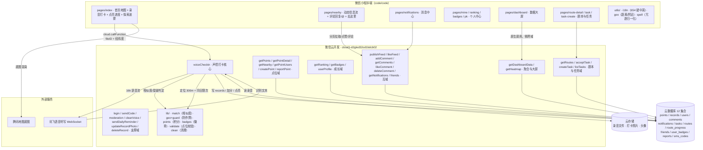
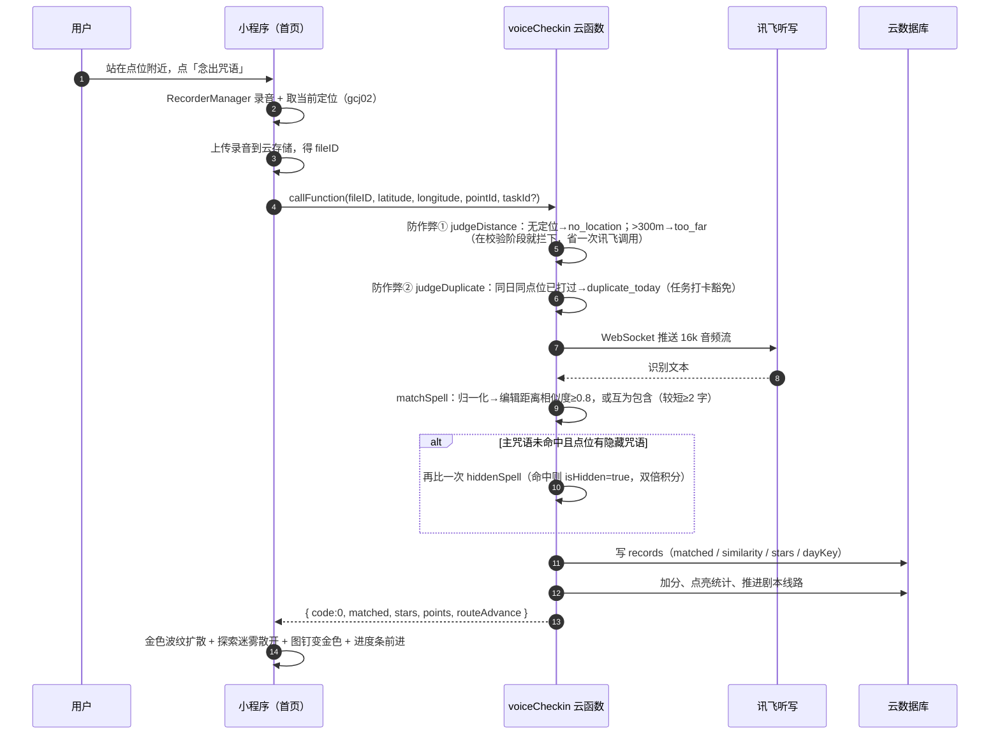

# 依声游理 · 校园声控打卡小程序

> **把校园地图做成一张「会发声」的游戏地图** —— 走到打卡点、念出点位咒语，图钉点亮一格；集齐所有点位，整张地图被点亮。

微信小程序 + 微信云开发（CloudBase）实现的**声控（语音口令）校园打卡游戏**，面向北京理工大学良乡校区，以「延安根、军工魂」校史话术作为点位咒语（如 `明德精工`、`我爱文萃`、`延安根军工魂`）。

- 主色 `#4A90D9`（清新蓝）+ 北理工校徽 / 1940 水印
- TabBar：**首页 · 动态 · 消息 · 我的**
- 23 个页面 · 32 个云函数 · 12 张云数据库集合 · 中英双语 654 条文案

---

## 一、功能一览

| 模块 | 能力 |
|---|---|
| **声控打卡** | 录音上传 → 讯飞语音听写 → 与点位咒语做归一化相似度比对（编辑距离 ≥ 0.8，或互为包含且较短一方 ≥ 2 字）→ 写打卡记录、加分、点亮图钉 |
| **星级评价** | 相似度 ≥0.9 三星 / ≥0.7 两星 / 其余一星，给玩家「念得好不好」的即时反馈 |
| **隐藏咒语** | 每个点位可藏一条隐藏咒语（明文只在服务端），念对额外 +10 分（双倍），线索以 `hiddenClue` 形式给出 |
| **防作弊（服务端）** | ① 定位必须到达点位 **300 米**内（haversine，先于讯飞调用拦截）② 同日同点位只算一次（任务打卡豁免）③ `dayKey` 按 **UTC+8** 自然日切日 |
| **地图点亮 / 探索迷雾** | 已打卡点位金色图钉；未点亮区域覆一层「中心透明、四周渐浓」的雾，点亮进度越高雾越薄，打卡瞬间波纹扩散 + 雾散开 |
| **剧本任务线** | 四幕校史剧情《精工之魂》按顺序推进，完成整条线路 +50 分（`route_progress` 记录进度） |
| **任务系统** | 玩家互相指派打卡任务：完成 +20，发布被完成 +5，首页底部常驻任务提示条 |
| **动态** | 单列信息流（图文打卡动态）、点赞、评论与回复 / `@`（被回复者收订阅消息）、「去这里」跳地图定位 |
| **消息** | 点赞/评论/好友/回复四类通知、未读角标、一键全部已读、长按单条删除 |
| **排行 & 徽章 & PK** | 积分榜 TOP10（连击奖励 min(n,5)×5 封顶）、成就徽章、好友 PK |
| **数据大屏** | 小程序内置 `pages/dashboard`：今日/累计打卡、活跃玩家、点亮进度、点位热度、实时打卡流、排行榜、剧本完成率环形；30s 自动刷新。另附网页版 `dashboard/index.html`（GitHub Pages，投影/答辩备用） |
| **体验层** | 中英双语（654 键，0 硬编码）、暗色模式、大字体、新手引导（功能介绍 swiper + 锚点式三步实操引导）、打卡点亮动画、校徽启动页 |

---

## 二、技术栈

| 层 | 技术 |
|---|---|
| 前端 | 微信小程序原生框架（WXML / WXSS / JS），无第三方 UI 库、无自定义组件目录 |
| 后端 | 微信云开发（CloudBase）：云函数（Node.js 16）+ 云数据库（文档型）+ 云存储 |
| 语音 | 讯飞开放平台「语音听写」WebSocket 流式接口（16k 裸 PCM/WAV） |
| 地图 | 微信 `<map>` 组件（gcj02）+ 腾讯地图底图 |
| 工具链 | Node.js 本地测试（纯 node 脚本，零依赖）、`tools/*.js` 自研校验器 |

后端 **32 个云函数**按功能内聚拆分，公共判定逻辑抽成 `lib/` 纯函数（不依赖 `wx-server-sdk`），因此可在本地直接单测。

---

## 三、系统架构



### 打卡一次发生了什么



---

## 四、目录结构

```
mini-program-demo/
├── code/code/                  # 小程序工程（用微信开发者工具导入这一层）
│   ├── app.js / app.json / app.wxss
│   ├── pages/                  # 23 个页面
│   │   ├── splash/             # 校徽启动页
│   │   ├── index/              # 首页：地图 / 录音打卡 / 点亮进度 / 探索迷雾 / 新手引导
│   │   ├── nearby/             # 动态（tabBar）
│   │   ├── notifications/      # 消息（tabBar）
│   │   ├── mine/               # 我的（tabBar，含数据大屏入口）
│   │   ├── dashboard/          # 数据大屏
│   │   ├── ranking/ badges/ pk/
│   │   ├── route-detail/ task/ task-create/
│   │   ├── point-create/ point-list/ point-detail/
│   │   ├── records/ profile/ user-profile/ feed-publish/
│   │   └── login/ settings/ about/ agreement/
│   ├── utils/                  # i18n.js / geo.js / spell.js
│   ├── images/                 # 校徽、背景、tabBar 图标
│   └── cloudfunctions/         # 32 个云函数（每个含 package.json + index.js）
│       └── */lib/              # 公共纯函数（可本地单测）
├── dashboard/index.html        # 网页版数据大屏（GitHub Pages 备用）
├── tools/                      # 本地质量保障脚本（零依赖）
│   ├── test-all.js             # 一键跑全部单测
│   ├── test-voice-match.js     # 咒语归一化/相似度/匹配/星级
│   ├── test-points.js          # 积分与连击封顶
│   ├── test-badges.js          # 徽章与连续天数
│   ├── test-point-create.js    # 点位参数校验
│   ├── test-clean-voice.js     # 录音过期清理与分片
│   ├── test-geo.js             # 前端距离/附近筛选
│   ├── test-guard.js           # 防作弊 300m 边界 / UTC+8 dayKey / 任务豁免
│   ├── check-i18n.js           # 中英键一致性 + 页面硬编码扫描
│   ├── check-json.js           # 全部 json 合法性
│   ├── check-require.js        # 云函数 require 路径可达性
│   └── check-sync.js           # 前后端咒语归一化逐字同步
├── PROJECT_LOG.md              # 迭代日志（F-01 ~ F-23）
└── README.md
```

---

## 五、云函数清单（32 个）

| 域 | 云函数 | 职责 |
|---|---|---|
| **打卡核心** | `voiceCheckin` | 声控判定主流程：防作弊 → 讯飞识别 → 咒语匹配（含隐藏咒语）→ 写记录/加分/点亮/推进剧本 |
| | `cleanVoice` | 清理过期录音（分批 deleteFile） |
| **点位** | `getPoints` / `getPointDetail` / `getNearby` / `getPointUsers` | 点位列表（剥掉隐藏咒语明文）、详情、附近、玩家列表 |
| | `createPoint` | 玩家自建点位（名称/咒语/半径/坐标校验 + 数量上限） |
| | `reportPoint` | 举报违规点位 |
| **成长** | `getRanking` | 积分榜聚合 + 连击奖励 |
| | `getBadges` | 徽章达成与连续打卡统计 |
| | `userProfile` / `updateRecordPhoto` / `deleteRecord` | 个人资料、打卡照片更新、删除记录 |
| **剧本/任务** | `getRoutes` | 剧本线路 + 我的进度 |
| | `acceptTask` / `createTask` / `listTasks` | 任务指派、发布、列表 |
| **互动** | `publishFeed` / `likeFeed` | 动态发布、点赞 |
| | `addComment` / `getComments` / `likeComment` / `deleteComment` | 评论、回复/@、评论点赞与删除 |
| | `getNotifications` | 消息列表 / 全部已读 / 单条删除（共用 `action`） |
| | `friends` | 邀请码绑定、好友列表 |
| **聚合** | `getDashboardData` | 数据大屏一次性聚合（逐段容错，单段失败不影响其它指标） |
| | `getHeatmap` | 点位热度 |
| **支撑** | `login` / `sendCode` | 登录与会话、短信验证码 |
| | `moderation` | 内容安全检测 |
| | `sendDailyReminder` | 每日打卡提醒（订阅消息） |

> 部署提示：新建云函数必须带 `package.json`（`wx-server-sdk` 依赖），右键选「上传并部署：云端安装依赖」，否则云端报 `Cannot find module 'wx-server-sdk'`。批量部署时若报 `当前函数处于Updating状态`，等 1~5 分钟重试即可。

---

## 六、云数据库集合（12 张）

| 集合 | 内容 |
|---|---|
| `points` | 打卡点位（名称、咒语、隐藏咒语/线索、经纬度、半径、创建者） |
| `records` | 打卡记录（openid、pointId、matched、similarity、stars、dayKey、照片） |
| `users` | 用户（昵称、头像、邀请码、积分、性别/地区） |
| `comments` | 动态评论（含 `replyTo` 回复链） |
| `notifications` | 通知（like / comment / friend / reply） |
| `tasks` | 打卡任务（指派/发布/完成状态） |
| `routes` | 剧本线路（四幕步骤、奖励） |
| `route_progress` | 玩家线路进度（`currentIndex` / `completed`） |
| `friends` | 好友关系 |
| `user_badges` | 已获得的徽章 |
| `reports` | 点位举报 |
| `sms_codes` | 短信验证码 |

> `routes`、`route_progress` 不会自动创建，需在云开发控制台手动新建集合，否则首次调用报 `-502005`。

---

## 七、本地运行

1. **导入工程**：微信开发者工具 → 导入项目 → 目录选 `code/code`（不是仓库根）
2. **填 AppID**：`project.config.json` 换成自己的小程序 AppID
3. **选云环境**：`app.js` 中 `cloud.init({ env: 'cloud1-d2gled32od1bdcb02' })` 换成自己的环境 ID
4. **建集合**：控制台按上表创建 12 个集合（初始可用空集合）
5. **部署云函数**：`cloudfunctions/` 下每个目录右键「上传并部署：云端安装依赖」
6. **配置讯飞**：`cloudfunctions/voiceCheckin/index.js` 内 APPID / API_KEY / API_SECRET 换成自己的讯飞凭据（建议改用云函数环境变量）
7. **跑本地校验**（仓库根，纯 node，无需 `npm install`）：

```bash
node tools/test-all.js        # 7 个测试脚本、384 条断言
node tools/check-i18n.js      # 中英 654 键一致性 + 硬编码扫描
node tools/check-json.js      # 全部 json 合法性
node tools/check-require.js   # 云函数 require 路径
node tools/check-sync.js      # 前后端归一化规则逐字一致
```

---

## 八、质量保障

- **纯函数单测 384 条断言**：咒语判定、积分/连击、徽章、点位校验、录音清理、前端距离、防作弊边界，全部 `node` 直跑，零框架依赖，答辩现场可当场演示
- **边界值钉死**：`299.9m 通过 / 300.1m 拒绝`、`UTC 16:30 → 北京次日` 跨日、`isFinite(null)` 缺陷（空定位不能伪装成赤道坐标）都已被测试覆盖
- **一致性校验器**：i18n 中英键、前后端咒语归一化规则、云函数依赖路径、json 合法性，四条自动化闸门
- **云端双保险**：前端 inRange 只是"提示"，真正的判定在云函数（前端参数可被改）

---

## 九、迭代日志

完整迭代过程（F-01 ~ F-23：防作弊、评论回复/@、数据大屏排障链路、新手引导、探索迷雾等）见 [`PROJECT_LOG.md`](./PROJECT_LOG.md)。

网页版数据大屏：`https://hjhcom.github.io/mini-program-demo/dashboard/index.html`（需腾讯云 HTTP 网关跨域放通才能读实时数据，否则展示演示数据；答辩建议用小程序内置大屏页）。
